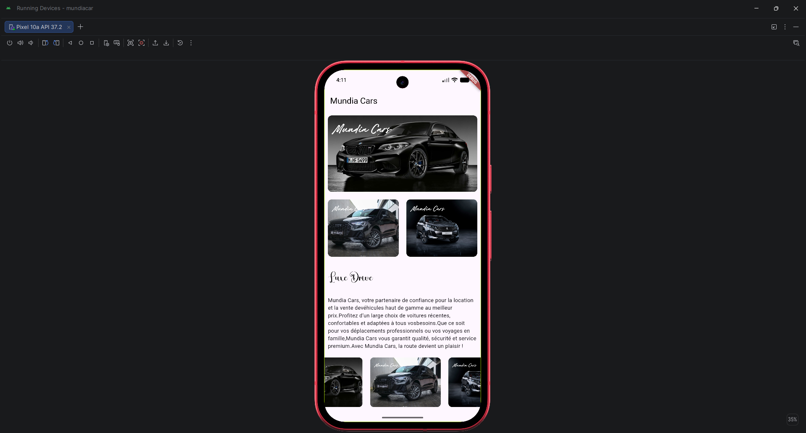

# 🚗 Mundia Cars

Application mobile **Flutter** de présentation d'une agence de location et de vente de véhicules haut de gamme.
Projet réalisé dans le cadre du cours **Développement Mobile (2ACINF)** – Université Mundiapolis.

> Le texte, les images et les polices (`fontFamily`) utilisés dans l'application ont été fournis par l'enseignant.

---

## 📸 Aperçu

<p align="center">
  
</p>

## 🎬 Démonstration vidéo

▶️ [Voir la vidéo de démonstration](docs/Application_Mobile_Mundia_Cars_Video.mp4)

La vidéo montre l'application lancée sur l'émulateur **Pixel 10a** depuis Android Studio, y compris le passage en mode paysage.

---

## ✨ Fonctionnalités

- Barre d'application (`AppBar`) avec le titre « Mundia Cars »
- Grande image mise en avant (BMW) avec coins arrondis et texte en filigrane
- Deux images côte à côte (Audi Q3 et Peugeot 3008) grâce à `Row` et `Expanded`
- Titre « Luxe Drive » avec une police personnalisée
- Paragraphe de présentation justifié
- **Carrousel horizontal** d'images en bas de page
- Page défilable, utilisable en portrait comme en paysage

## 🧱 Widgets Flutter utilisés

| Widget | Rôle |
|---|---|
| `MaterialApp` / `Scaffold` / `AppBar` | Structure générale de l'application |
| `ListView` | Page verticale défilable |
| `Container` + `BoxDecoration` + `DecorationImage` | Images avec coins arrondis (`BorderRadius`) |
| `Row` + `Expanded` | Deux images qui se partagent la largeur |
| `Text` + `TextStyle(fontFamily: ...)` | Textes avec polices personnalisées |
| `SizedBox` + `ListView(scrollDirection: Axis.horizontal)` | Carrousel horizontal |
| `MediaQuery` | Largeur des cartes du carrousel (45 % de l'écran) |

## 📁 Structure du projet

```
mundiacar/
├── assets/
│   ├── fonts/
│   │   ├── charm.otf
│   │   └── vintage.ttf
│   └── images/
│       ├── bmw.jpg
│       ├── peugot.jpg
│       ├── prado.jpg
│       └── q3.jpg
├── docs/
│   ├── mundiaCars.png
│   └── Application_Mobile_Mundia_Cars_Video.mp4
├── lib/
│   └── main.dart
└── pubspec.yaml
```

## ⚙️ Configuration du `pubspec.yaml`

Les images et les polices doivent être déclarées (attention à l'indentation) :

```yaml
flutter:
  uses-material-design: true

  assets:
    - assets/images/

  fonts:
    - family: charm
      fonts:
        - asset: assets/fonts/charm.otf
    - family: vintage
      fonts:
        - asset: assets/fonts/vintage.ttf
```

## ▶️ Lancer le projet

**Prérequis :** Flutter SDK, Android Studio (ou VS Code) et un émulateur ou un téléphone Android.

```bash
# 1. Cloner le dépôt
git clone https://github.com/Ilyas-SEKHSOUKHI/mundia-cars-flutter.git
cd mundiacar

# 2. Récupérer les dépendances
flutter pub get

# 3. Lancer l'application
flutter run
```

## 🛠️ Technologies

- [Flutter](https://flutter.dev/)
- [Dart](https://dart.dev/)

## 👤 Auteur

**Ilyas** – Cycle ingénieur informatique, Université Mundiapolis (Casablanca)